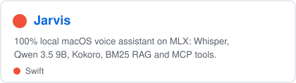
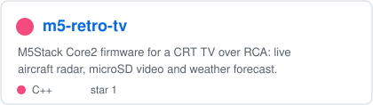
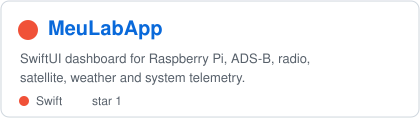

<pre align="center">
<strong>Eliel Felipe Junior |</strong> <a href="https://elielfelipe.com.br">Website</a> | <a href="https://meulab.fun">MeuLab</a> | <a href="https://github.com/eliel9012">GitHub</a> | <a href="https://www.linkedin.com/in/elielfelipe/">LinkedIn</a> | <a href="https://orcid.org/0000-0002-6333-1187">ORCID</a>
</pre>

  
  
  

I am a Brazilian lawyer (OAB/SP) working in contracts, data protection (LGPD), intellectual property and AI governance, and a self-taught developer. I build local AI systems, reproducible data pipelines and hardware projects.

I take care of the part demos usually skip: permissions, traceability, human oversight and measurable results. I work in Portuguese, English, French, Spanish and Italian.

## Highlights

**Jarvis** is a voice assistant for macOS that runs entirely on the machine. Speech goes through Whisper, a Qwen 3.5 9B model and Kokoro TTS, all on Apple MLX. A local BM25 index answers from your own notes and returns the sources it used. Tools are called over MCP through a hand-written stdio client, with no SDK. A FastAPI backend serves a SwiftUI app, every pipeline stage has a benchmark, and the repo ships 17 backend tests and 24 app tests.

**OpenSky Franca coverage** documents the volunteer ADS-B receiver I run for the OpenSky Network in Franca, Brazil. Over 137 days it recorded 36.5 million ADS-B positions from 4,925 aircraft, with 99.54% receiver uptime. After an antenna replacement, mean range for the same fleet rose 15.6%. Raw data and analysis code are archived on Zenodo with DOIs ([dataset](https://doi.org/10.5281/zenodo.23090597), [code](https://doi.org/10.5281/zenodo.23089559)). Poster and short paper at the 14th OpenSky Symposium (Madrid, 2026). Live dashboard: [adsb.meulab.fun](https://adsb.meulab.fun).

**M5Retro-TV** is firmware for an M5Stack Core2 with an RCA module that drives a CRT television over NTSC composite video. It shows a live aircraft radar, plays video from microSD and has a weather forecast screen. Awarded Most Loved in the Schematik × M5Stack Build Season 2026.

## Current Focus

- AI agents and RAG, including knowing when a deterministic workflow beats an agent
- AI governance and privacy: LGPD, access control and human-in-the-loop review
- Data pipelines with provenance
- Self-hosted infrastructure

## Home Lab and Infrastructure

[MeuLab](https://meulab.fun) is my self-hosted lab: monitoring, telemetry and small services on Raspberry Pi machines, plus tools for network visibility.

## Aviation and Satellites

Live ADS-B, GPS/GNSS and satellite visualizations fed by local receivers.

## Tools and Retro Computing

Practical utilities, like VPN-aware flight price monitoring, and text systems for retro consoles such as the Sega Genesis.

## Recently Starred

  

  <a href="https://github.com/eliel9012">GitHub</a> |
  <a href="https://elielfelipe.com.br">elielfelipe.com.br</a> |
  <a href="https://meulab.fun">meulab.fun</a> |
  <a href="https://orcid.org/0000-0002-6333-1187">ORCID</a>

